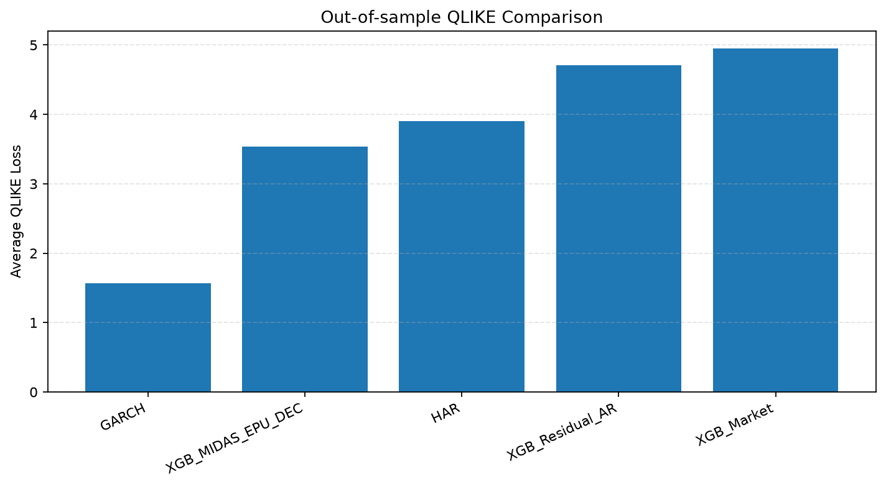

# Stock Volatility Forecasting with MIDAS EPU Correction

**Author: Boursin Nickel**

研究下一交易日平方收益率对数代理的预测，比较HAR、GARCH、XGB-Market、残差单独修正XGB-AR，以及加入月度EPU的DEC。

当前研究档案报告**稳定求解、日历修正与消融重分析**：DEC相对两个XGB对照在三个市场都降低QLIKE，但都提高MSE。它没有改善CSI300的区间质量。材料适合带限制阅读，不是已验证的实时预测系统；EPU真实发布版本与全新留出评估仍缺失。修订结论及“变好还是变差”的完整对照见[DEC方法修订](docs/dec-method-review.md)。

## 首次运行：不需要私人数据

先准备64位Python 3.12及平台原生运行库，见[前置环境](examples/README.md#前置环境)。先获取[公开仓库](https://github.com/NaiL00ng/stock-volatility-midas-epu)，以下macOS/Linux命令在项目根目录执行；Windows完整命令见[PowerShell步骤](examples/README.md#windows-powershell)。实际测试与静态检查分开记录在[平台验证](docs/platform-validation.md)。

```bash
git clone https://github.com/NaiL00ng/stock-volatility-midas-epu.git
cd stock-volatility-midas-epu
python3.12 --version
python3.12 -m venv .venv
.venv/bin/python -m pip install -r requirements-demo.txt
.venv/bin/python -m pip check
.venv/bin/python -c "import xgboost; print('XGBoost load OK')"
.venv/bin/python examples/synthetic_demo.py
.venv/bin/python scripts/check_demo_output.py
```

示例只生成虚构数据，复用当前DEC代码，输出写入`generated/synthetic-demo/`；不代表论文结果。最后一条命令独立复算评分并检查样本、日期和优化诊断。重复运行需指定新的空输出目录，并将该目录传给检查器的`--input`。完整输出解释及演练范围见[示例说明](examples/README.md)和[发布前演练](docs/release-rehearsal.md)。

当前真实数据实验使用`run_dec_revision.py`及`run_revised_intervals.py`，需要自备有权使用的输入及兼容构建。`run_experiments.py`保留作历史入口。三市场测试数量依次为1919、1919、1554；CSI300区间统一1859条，见[样本口径](configs/sample-splits.json)。

## 从哪里开始

- [相关文献差异](docs/related-work.md)：哪些设计已有先例、本项目可支持的贡献及尚缺的直接比较。
- [中文修订论文](paper/thesis-public.pdf)与[英文研究稿](paper/thesis-en.pdf)：同一组实验与限制，作者化名，无身份页与致谢；[源码、编译与论文引用](paper/README.md)。
- [当前结果](results/revised/README.md)：五模型、三市场、共同日期区间与数值验证。
- [运行说明](docs/reproduction.md)：安装、本地兼容构建、数据结构及修订实验入口。
- [版本对应表](docs/version-map.md)：明确历史与当前论文分别对应什么。
- [历史追溯](docs/provenance-resolution.md)：6888条XGBoost预测已逐点重现，旧DEC精确轨迹尚未恢复。
- [研究限制](docs/research-review.md)、[数据说明](data/README.md)、[上传清单](docs/upload-manifest.md)。
- [版本说明](docs/release-notes.md)：当前验证范围、仓库信息与发布状态；[许可范围](docs/licensing.md)及[第三方来源](THIRD_PARTY_NOTICES.md)。

## 当前CSI300结果

测试1919条。下表为修订实验；历史CSV与图件保留在原结果目录，不静默覆盖。

| 模型 | 对数MSE | 对数MAE | QLIKE |
| --- | ---: | ---: | ---: |
| GARCH | 7.375868 | 1.983865 | 1.564183 |
| XGB_MIDAS_EPU_DEC | 5.112644 | 1.725558 | 3.536964 |
| HAR | 4.905206 | 1.724860 | 3.905553 |
| XGB_Residual_AR | 5.094169 | 1.758021 | 4.705936 |
| XGB_Market | 5.099716 | 1.763086 | 4.951636 |



纳斯达克的验证最优规格由12个月Beta改为12个月指数Almon；相对旧DEC，MSE改善约0.99%，QLIKE变差约2.65%。更可靠的求解不保证每个测试指标改善。上证50正文结果已在特征构造前排除确认的休市行。

90%区间、校准窗口250、共同1859个日期上，DEC得分10.1995，高于HAR 9.6973、XGB-Market 9.8534及XGB-AR 9.8793。区间针对未来观测代理，不是潜在条件方差；统计诊断仍受回顾性分析、序列依赖和规格选择限制。

无需安装依赖即可核验分发文件：

```bash
python3 scripts/verify_package.py
python3 scripts/check_release_contract.py
```

## 文件结构与使用条件

`examples/`为合成示例，`paper/`为论文，`scripts/`为运行和检查入口，`results/revised/`为当前结果，`results/`其他目录保留历史证据，`docs/`为说明，`data/`仅提供输入规范。

运行输出写入`generated/`。本地`.venv/`、`generated/`、原始数据、模型和逐期预测不属于分发范围。分发范围以清单为准，不应将本地运行目录或父目录推送到仓库。

Copyright © 2026 Boursin Nickel。作者有权许可的**代码、可执行示例与运行配置采用[Apache-2.0](LICENSE)**；**中英文论文、说明文字和原创图表采用[CC BY 4.0](LICENSE-CONTENT.txt)**。这是按材料划分的授权，不是在两种许可证之间任选。具体范围、数值汇编和代码片段的处理见[许可说明](docs/licensing.md)及[NOTICE](NOTICE)。第三方材料保留[各自原有条款](THIRD_PARTY_NOTICES.md)，许可不覆盖底层行情与EPU数据。

软件引用见[CITATION.cff](CITATION.cff)，中英文论文引用见[论文说明](paper/README.md)。当前版本为0.5-review，[项目仓库](https://github.com/NaiL00ng/stock-volatility-midas-epu)按探索性研究档案提供；上传后的克隆与运行验收见[验证记录](docs/validation.md)。这不是期刊发表或实时预测能力认证。
